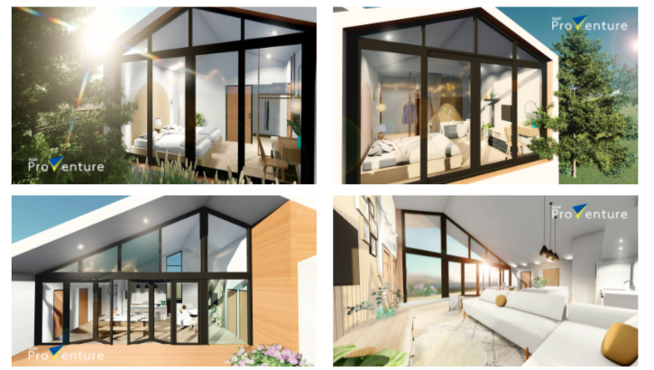

# Livable Showroom: behind-the-meter energy platform

Code behind EGAT's Behind-the-Meter Livable Showroom (2021–2022), a demonstration home that brings smart-meter, solar, weather and indoor-sensor data into ThingsBoard, computes a thermal-comfort (PMV) index and controls the air conditioner with a reinforcement-learning agent.

## What is in `main/`

| Folder | What it does |
|---|---|
| [`energy_sensors/`](main/energy_sensors), [`smartmeter/`](main/smartmeter) | Read Tuya smart meters and solar data (tinytuya) and weather APIs |
| [`env_sensors/`](main/env_sensors) | Xiaomi Zigbee temperature and humidity sensors (python-miio) and weather data, sent to ThingsBoard |
| [`thingsboards/`](main/thingsboards) | ThingsBoard helpers: device tokens, interval data and a Tuya-to-ThingsBoard bridge |
| [`comfort/`](main/comfort) | PMV thermal-comfort index (pythermalcomfort) published to ThingsBoard |
| [`control_device/`](main/control_device) | Air-conditioner control through the Airconet API and a reinforcement-learning agent (keras-rl, TensorFlow), with trained weights in `model/` |
| [`Enzyplatform/`](main/Enzyplatform) | Client for the ENZY platform API |

[`Prince.ipynb`](Prince.ipynb) analyses meter data and features from early 2022 (pandas, scikit-learn, Plotly).

## Notes

- The code targets the showroom's own devices (Tuya, Xiaomi, Airconet) and its ThingsBoard server, so it will not run as is elsewhere.
- Device credentials and tokens are not included. Set your own before running anything.
- Design notes are linked from [`main/readme.md`](main/readme.md).
